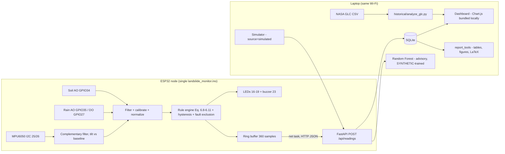

# Landslide Risk Monitoring and AI-Assisted Early Warning System

Final-year B.Tech prototype: **ESP32 firmware + FastAPI/SQLite backend + web dashboard + experimental Random Forest + historical (NASA GLC) analysis.**

> **Honest-use note.** This is an experimental engineering prototype. SAFE / WATCH / WARNING / CRITICAL are
> *prototype* risk states, not official geological warnings, and the score R is not a probability. The ML model is
> trained on a **synthetic** dataset. **Soil and rain calibration is UNVERIFIED** until you complete the `cal`
> wizard on the real hardware. Compiling the firmware or running the simulator does not show that the hardware works.

Contents: [1 Overview](#1-overview) · [2 Hardware](#2-hardware-bill-of-materials-and-wiring) · [3 Setup](#3-setup-windows-first) ·
[4 Bring-up](#4-hardware-bring-up-order) · [5 Troubleshooting](#5-troubleshooting) · [6 Experiments](#6-running-and-recording-the-four-scenarios) ·
[7 ML & report figures](#7-ml-training-and-report-figures) · [8 Historical](#8-historical-analysis-nasa-global-landslide-catalog) ·
[9 Demo script](#9-college-demo-script-23-minutes) · [10 Placeholders](#10-report-placeholders) · [11 Limitations](#11-limitations-and-honest-use) ·
[12 Verification](#12-what-was-verified-at-delivery)

---

## 1. Overview

The ESP32 reads a capacitive soil-moisture sensor, a rain sensor and an MPU6050. It normalizes and filters the readings, computes the report's Chapter 6 risk score
`R = 0.40·M + 0.30·Rr + 0.30·T`, and drives four LEDs and a buzzer **locally**, so alerts never depend on Wi-Fi. When the network is up, it POSTs telemetry to the backend. The backend stores readings in SQLite, adds an **advisory** Random Forest class, flags disagreement and serves the dashboard.



Repository layout:

```
landslide-monitor/
├── firmware/landslide_monitor/   landslide_monitor.ino (ALL firmware logic), platformio.ini, secrets.example.h, .gitignore
├── backend/        FastAPI app, SQLite, Python port of the risk engine, ML advisor, .ino config reader
├── dashboard/      index.html, app.js, styles.css, vendor/chart.umd.min.js (Chart.js 4.4.1, MIT)
├── ml/             train_model.py, evaluate_real.py, data/ (synthetic CSV, unchanged), outputs/ (SYNTHETIC results)
├── historical/     analyze_glc.py (needs the NASA GLC CSV you download)
├── simulator/      simulate.py (replay CSV / live scenarios, tagged simulated)
├── report_tools/   make_report.py (real device data by default)
├── tests/          pytest suite, vectors/risk_vectors.json, firmware_host/ C++ harness
├── docs/           REPORT_EXTRACT, OPEN_QUESTIONS, CALIBRATION, TROUBLESHOOTING, DATASET_AND_ML, PLACEHOLDER_MAP, VERIFICATION, reference/main.pdf
├── requirements.txt  .env.example  .gitignore  pytest.ini
```

**Single source of truth.** All pins, thresholds and tunables are in the `CONFIG` block at the top of `landslide_monitor.ino`. The Python risk engine, simulator, dashboard thresholds and GPIO table generator **read that block**. Values marked `PROVISIONAL` are not in the report. See [docs/OPEN_QUESTIONS.md](docs/OPEN_QUESTIONS.md).

---

## 2. Hardware: bill of materials and wiring

Uses only parts you already have.

| Qty | Part | Notes |
|---|---|---|
| 1 | ESP32 DevKit (ESP32-WROOM-32 assumed; confirm your module) | 3.3 V logic, 12-bit ADC |
| 1 | Capacitive soil-moisture sensor (analog) | AO must stay ≤ 3.3 V |
| 1 | Rain sensor module (plate + comparator board, AO + DO) | power at 3.3 V so AO ≤ 3.3 V |
| 1 | MPU6050 (GY-521 breakout) | I²C address 0x68 (AD0 LOW) / 0x69 (AD0 HIGH) |
| 4 | LEDs: green, yellow, orange, red | each with a 220–330 Ω resistor |
| 1 | Active buzzer | via NPN transistor (e.g. 2N2222/BC547 + 1 kΩ base resistor) if it draws more than ~12 mA |
| — | Breadboard, jumper wires, USB data cable | |

**Current wiring (pin map in the .ino CONFIG block):**

| Signal | ESP32 GPIO | Notes |
|---|---|---|
| Soil AO | 34 | ADC1_CH6, input-only, works with Wi-Fi |
| Rain AO | 35 | ADC1_CH7, input-only, works with Wi-Fi |
| Rain DO (optional) | 27 | digital cross-check only; set `PIN_RAIN_DO = -1` if unused |
| MPU6050 SDA | 25 | I²C only — not used for anything else |
| MPU6050 SCL | 26 | I²C only — not used for anything else |
| LED SAFE (green) | 16 | 220–330 Ω to LED anode, cathode to GND |
| LED WATCH (yellow) | 17 | ″ |
| LED WARNING (orange) | 18 | ″ |
| LED CRITICAL (red) | 19 | ″ |
| Buzzer | 23 | through a transistor if needed |
| Sensor VCC / GND | 3V3 / GND | common ground for everything |

> GPIO 16/17 are used for PSRAM on **WROVER** modules. The firmware prints `PSRAM: YES` at boot if so; move those two LEDs.
> Measure each analog output with a multimeter before connecting. **Never feed more than 3.3 V into GPIO 34/35.**

```
                      ESP32 DevKit
                 ┌──────────────────────┐
  Soil AO ───────┤ GPIO34          3V3  ├──── VCC: soil, rain, MPU6050
  Rain AO ───────┤ GPIO35          GND  ├──── GND: all modules, LED cathodes, transistor emitter
  Rain DO ───────┤ GPIO27               │
  MPU SDA ───────┤ GPIO25       GPIO16  ├──[220Ω]──►|── GND   green  SAFE
  MPU SCL ───────┤ GPIO26       GPIO17  ├──[220Ω]──►|── GND   yellow WATCH
                 │              GPIO18  ├──[220Ω]──►|── GND   orange WARNING
                 │              GPIO19  ├──[220Ω]──►|── GND   red    CRITICAL
                 │              GPIO23  ├──[1kΩ]── B  NPN  C ── buzzer(−)   buzzer(+) ── 3V3/5V
                 └──────────────────────┘                E ── GND
```

**Local alerts:** one LED per state. Buzzer off for SAFE/WATCH, slow beep for WARNING (0.3 s every 1.5 s),
fast beep for CRITICAL (0.12 s on/off). **Fault (no usable component, state UNKNOWN):** all four LEDs flash together
once per second plus a short chirp every 15 s. **DEGRADED** (some sensors excluded): the state LED blinks off briefly
every 2 s, and the WARNING/CRITICAL buzzer keeps sounding.

---

## 3. Setup (Windows first)

### 3.1 Python environment and backend
Install Python 3.10+ from python.org (tick "Add python.exe to PATH"). In **PowerShell**, in the `landslide-monitor` folder:

```bash
python -m venv .venv
```
```bash
.venv\Scripts\Activate.ps1
```
```bash
pip install -r requirements.txt
```
```bash
copy .env.example .env
```
```bash
python -m backend.run
```

If PowerShell refuses to run `Activate.ps1`, run `Set-ExecutionPolicy -Scope CurrentUser RemoteSigned` once, or skip activation and call `.venv\Scripts\python` directly.
macOS/Linux: `python3 -m venv .venv`, `source .venv/bin/activate`, `cp .env.example .env`.

The backend prints its LAN IP and the exact URL the ESP32 must use, e.g. `ESP32 should POST to http://192.168.1.23:8000/api/readings`.
The first time, Windows Firewall asks to allow Python. Allow it on **Private** networks.

**Dashboard:** open `http://localhost:8000/` (or `http://<LAN-IP>:8000/` from a phone on the same Wi-Fi). Chart.js is bundled, so it works without internet.
API docs: `http://localhost:8000/docs`.

### 3.2 Firmware secrets
Copy `firmware/landslide_monitor/secrets.example.h` to `secrets.h` in the same folder. Set your 2.4 GHz Wi-Fi SSID and password, and set `API_HOST` to the LAN IP printed by the backend. `secrets.h` is git-ignored and contains no logic. Without it, the sketch still runs; Wi-Fi is simply disabled.

### 3.3 Arduino IDE
1. Arduino IDE 2.x → *File › Preferences › Additional boards manager URLs*: `https://espressif.github.io/arduino-esp32/package_esp32_index.json`
2. *Tools › Board › Boards Manager* → install **esp32 by Espressif Systems**. Version **2.0.17** matches the PlatformIO build that was compile-checked. 3.x avoids changed APIs but was not compile-checked.
3. Open `firmware/landslide_monitor/landslide_monitor.ino`. The folder name must stay `landslide_monitor`.
4. *Tools*: Board **ESP32 Dev Module**, Upload Speed 921600, Flash 4MB, Partition "Default 4MB with spiffs", the right **Port**.
5. Upload, then *Serial Monitor* at **115200** with line ending **Newline**.

No extra libraries are needed. Wire, WiFi, HTTPClient and Preferences ship with the ESP32 core.

### 3.4 PlatformIO (same .ino, `src_dir = .`)
```bash
pip install platformio
```
```bash
cd firmware/landslide_monitor
```
```bash
pio run
```
```bash
pio run -t upload
```
```bash
pio device monitor
```

---

## 4. Hardware bring-up order

Use the serial commands, in this order. Each one reports what it found; don't continue past a failing step.

| Step | Command | Pass condition | If it fails |
|---|---|---|---|
| 0 | (boot) | Lamp test: 4 LEDs in turn + beep; `MPU6050 found at 0x68` | Check LED wiring; see §5 |
| 1 | `scan` | Device at 0x68 or 0x69 | [Troubleshooting §1](docs/TROUBLESHOOTING.md#1-mpu6050-reports-an-ic-fault-and-tilt-is-excluded) |
| 2 | `raw` | Soil/rain change when touched/wetted, not stuck at 0/4095; `\|a\|≈1.00 g` | §2, §3 of Troubleshooting |
| 3 | `cal` | Each step "accepted", then "calibration SAVED" for soil and rain | [docs/CALIBRATION.md](docs/CALIBRATION.md) |
| 4 | `baseline` | "Baseline SAVED: alpha0=…" (also step 5 of `cal`) | Keep the model still; check `\|a\|` |
| 5 | `status` | Soil/rain CALIBRATED, MPU BASELINE SET, health OK, `last_http=200` | §4 of Troubleshooting |
| 6 | monitoring | Log line every 5 s; dashboard shows **REAL DEVICE** | — |

Other commands: `help`, `reset` (erases calibration; needs `yes erase`).
During `cal`/`baseline`, type `ok` to collect, `skip` to skip a sensor, `abort` to stop.

---

## 5. Troubleshooting

Full guide: **[docs/TROUBLESHOOTING.md](docs/TROUBLESHOOTING.md)**. Short version for the symptoms seen so far:

* **MPU6050 I²C fault:** the old firmware used SDA 21/SCL 22; the wiring is now 25/26, so flash this sketch. Then `scan`, solder the headers, check 3V3/GND, and try swapping SDA/SCL.
* **Rain ADC = 0:** almost always wiring. AO must go to GPIO 35, VCC and GND connected, plate cable attached, plate not shorted. Compare with `rain_do`.
* **Soil ≈ 347, uncalibrated:** "uncalibrated" is expected until `cal`. Check that `raw` changes between air and water. NE555-based v1.2 boards may not work at 3.3 V; measure AO before powering them at 5 V.
* **Connection refused:** this is a backend/network issue, not a sensor issue. Start the backend, put the LAN IP (not localhost) in `secrets.h`, use the same Wi-Fi, allow port 8000 in Windows Firewall (Private profile), and test `http://<IP>:8000/api/health` from a phone.
* **ADC2 + Wi-Fi:** the analog sensors are on ADC1 (34/35). ADC2 pins can't be read while Wi-Fi is on.
* **Upload fails:** hold BOOT while "Connecting…", use a data cable, close the Serial Monitor, install the CP210x/CH340 driver.

---

## 6. Running and recording the four scenarios

These are the report's Table 10.1 scenarios. Calibrate first (§4); otherwise soil/rain are excluded and results are meaningless.

1. Backend running, dashboard open, **Data: Real device only**.
2. *Experiments & export* tab → name the run (e.g. `S2 gradual wetting run 1`), choose the scenario, add notes (water volume, timing, tilt method) → **Start**.
3. Perform the scenario. Leave 2 minutes of undisturbed baseline at the start of each run.
   * **1 Dry:** leave the slope untouched for 10 min.
   * **2 Gradual wetting:** add a fixed volume (e.g. 50 ml) every 2 min at the same spot near the probe.
   * **3 Heavy rain:** spray the slope and rain plate continuously for a fixed time.
   * **4 Combined stress:** wet as in 3, then tilt the model base in small measured steps (e.g. 1° wedges).
4. **Stop** the experiment. Export the CSV from the same tab.
5. Repeat each scenario (e.g. 3 runs). Log every run in report Table B.2.

Simulated runs for testing the software (always tagged `simulated`):
```bash
python simulator/simulate.py live --scenario heavy_rain --duration 120
```
```bash
python simulator/simulate.py replay --experiments EXP-001,EXP-027 --speed 60
```
```bash
python simulator/simulate.py live --scenario gradual_wetting --fault mpu --fast
```

---

## 7. ML training and report figures

```bash
python ml/train_model.py
```
This writes `ml/outputs/metrics.json`, `rf_model.joblib` and the PNG figures, all labelled **SYNTHETIC**, and takes about 3 minutes.
It splits by `experiment_id` (no experiment appears in both train and test) and uses `class_weight="balanced"` with a 24-combination grid.
Results and caveats: [docs/DATASET_AND_ML.md](docs/DATASET_AND_ML.md). The backend reloads the model when restarted.

Evaluate on **real** readings once you have them (agreement with the rule engine is not validation):
```bash
python ml/evaluate_real.py --csv real_device_export.csv
```

Report tables and figures from SQLite (real device records only by default):
```bash
python report_tools/make_report.py
```
This writes `report_tools/outputs/`: `table_5_1_gpio.tex` (from the .ino pins), `table_10_2_summary.tex`, `table_10_3_transitions.tex`,
`latency.json/.tex`, `ts_*.png` and `manifest.json` (which lists what is still missing).
`--allow-simulated` includes simulated rows and watermarks every figure and table **SIMULATED**. Never use those outputs for the report's [DATA].

---

## 8. Historical analysis (NASA Global Landslide Catalog)

The catalogue is **not bundled** and is never substituted. Download the CSV from the NASA Open Data Portal:
<https://data.nasa.gov/dataset/global-landslide-catalog> (report ref. [14]). Note the download date.
```bash
python historical/analyze_glc.py --input C:\path\to\Global_Landslide_Catalog_Export.csv
```
This writes `historical/outputs/summary.json` (input filename, SHA-256, analysis date, trigger shares with a re-check of the report's 38/18/10/6 %, top countries, monthly/yearly counts, fatality/injury statistics) and the trigger, country, seasonality and fatality figures. The dashboard's *Historical insights* tab shows them.
These are **event records**. They are kept separate from sensor measurements and never used to train the sensor model.

---

## 9. College demo script (2–3 minutes)

1. **(20 s) Problem and honesty.** "A low-cost multi-sensor prototype on a miniature slope. It gives prototype risk states, not landslide predictions."
2. **(30 s) Hardware.** Point at the soil probe, rain plate and MPU6050. Run `status` on the Serial Monitor to show sensor health and calibration status (say UNVERIFIED if calibration isn't done).
3. **(40 s) Local alert without Wi-Fi.** Wet the rain plate and soil, or tilt the model. Watch LEDs step up and the buzzer change. Unplug the router or stop the backend: alerts continue, and `status` shows buffered samples.
4. **(40 s) Dashboard.** Restore the network. Show the live cards, the R chart with τ lines, the state timeline and the event log. Show the ML advisory panel: "trained on synthetic data, advisory only; the rule engine decides."
5. **(20 s) Fault handling.** Unplug the MPU6050 SDA wire. Tilt is excluded, health shows DEGRADED, and weights re-normalize. With nothing usable the state is UNKNOWN, never SAFE.
6. **(10 s) Close.** Show limitations (§11) and future work (calibrated sensors, field trials).

Backup if the hardware fails: set Data to *Simulated only* and run `python simulator/simulate.py live --scenario combined_stress --duration 90`. Say clearly that it is simulated; the dashboard shows a banner.

---

## 10. Report placeholders

Every `[INSERT]`, `[DATA]` and `[VERIFY]` in `main.pdf` is mapped to the experiment, script or command that fills it in
**[docs/PLACEHOLDER_MAP.md](docs/PLACEHOLDER_MAP.md)**. Provisional design values and report conflicts are in
**[docs/OPEN_QUESTIONS.md](docs/OPEN_QUESTIONS.md)**. What the report specifies is in [docs/REPORT_EXTRACT.md](docs/REPORT_EXTRACT.md).

---

## 11. Limitations and honest use

* **Synthetic data is for software and ML development only.** Experimental results (Tables 10.2, 10.3, Ch. 11 plots, latency) must come from real prototype runs recorded with this system.
* **Calibration:** the soil/rain placeholders 3100/1300 and 3600/1200 are unverified and unused. Indices exist only after `cal`, and they are relative indices, not volumetric water content or rainfall rate.
* Thresholds τ, β, component limits, N, L, r_th and hysteresis are **provisional** (not in the report).
* Tilt is the sensor's inclination change, not slope displacement. The MPU6050 drifts, and baselines are manual.
* The miniature model is not a scaled replica of a real slope. There is no field validation, and the ML labels' origin is unknown (they may just reproduce rules).
* The NASA GLC has reporting bias and a rainfall focus. It is context only.

---

## 12. What was verified at delivery

Full commands and outputs are in **[docs/VERIFICATION.md](docs/VERIFICATION.md)**. In short:

| Check | Result |
|---|---|
| PlatformIO compile (`espressif32@6.9.0`, Arduino-ESP32 2.0.17, `esp32dev`) | **PASS**, 0 warnings, with and without `secrets.h` |
| Arduino IDE / arduino-cli compile | **NOT PERFORMED**: arduino-cli could not be installed in the build environment |
| Backend startup + all endpoints | **PASS** (live server on 0.0.0.0:8000, HTTP checks) |
| Simulator → backend demo | **PASS** (simulated data only) |
| Automated tests (`python -m pytest`) | **58 passed**, 0 skipped. Includes the C++ engine extracted from the .ino vs the Python port on shared vectors |
| ML training/evaluation | **PASS**, SYNTHETIC: grouped held-out macro-F1 0.914, CRITICAL recall 0.939 (unstable across folds: 0.54–0.97) |
| Firmware on real hardware, sensors, calibration, Wi-Fi to backend | **NOT VERIFIED**: no physical device was available to this build |
| Historical analysis on the real NASA GLC | **NOT PERFORMED**: the dataset was not supplied (script tested on an 8-row test fixture only) |
